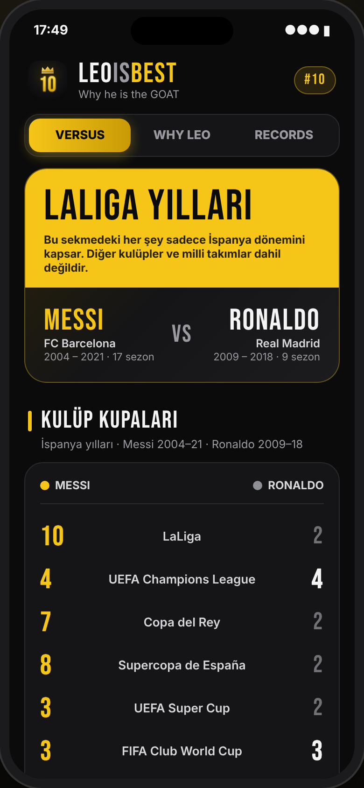
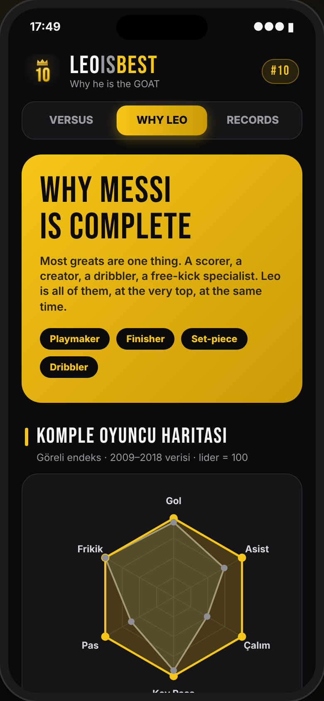
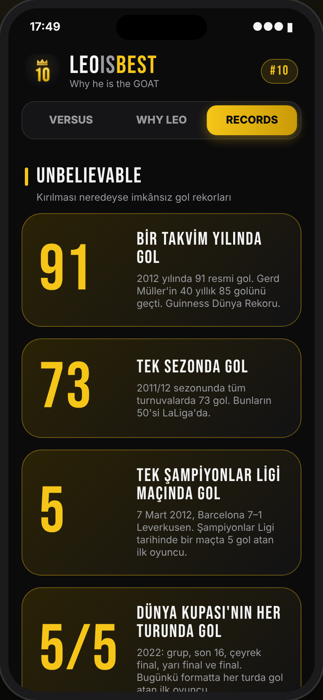
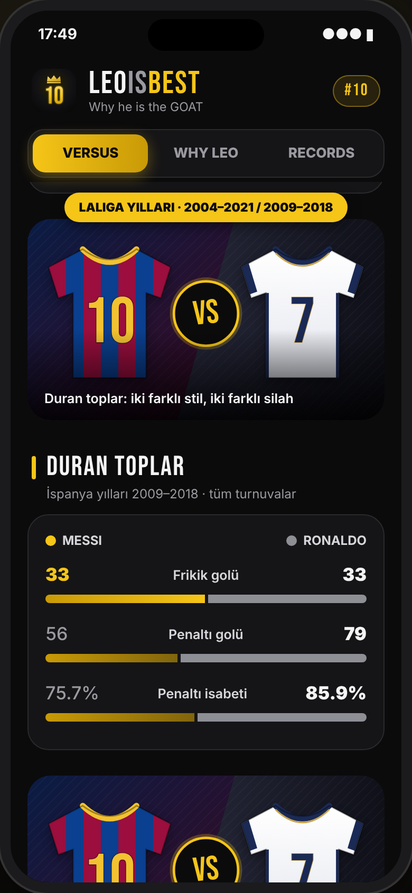
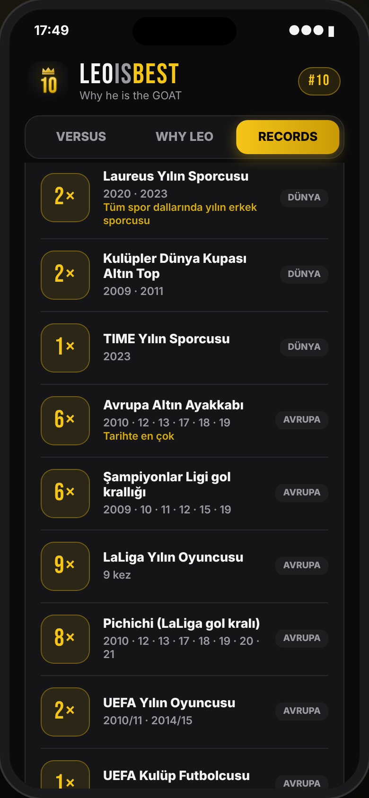
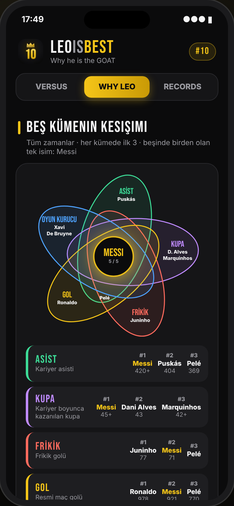
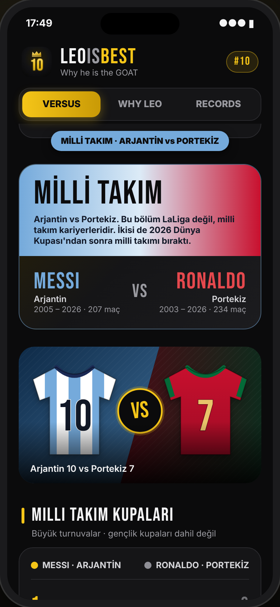

# leoisbest 🐐

**Why Lionel Messi is the best:** a Flutter app with three tabs, all in black, yellow and grey.

| Versus | Why Leo | Records | Jerseys | Awards | Venn | National team |
|:---:|:---:|:---:|:---:|:---:|:---:|:---:|
|  |  |  |  |  |  |  |

## Features

- **Segmented slider:** an animated selector that follows your finger as you swipe between pages
- **Versus (LaLiga years only):** a big *LALIGA YILLARI* banner at the top and a pill that stays pinned while you scroll, so it's clear this is the Spain period only. Club trophies from the Spain years (the leader's number is shown in bold), individual awards, El Clásico, a 9-season LaLiga goals chart, and comparison bars for goals, assists, free kicks, penalties, dribbles, key passes and efficiency. Between the stat groups sit hand-drawn jerseys: blue-garnet striped #10 and white-navy #7
- **Versus: national team (Argentina vs Portugal):** at the bottom of the tab. Includes international trophies (World Cup, Copa América/EURO, Finalissima, Nations League), caps, goals, assists, and World Cup goals, assists, finals and Golden Balls. The jerseys are a white shirt with light-blue vertical stripes for #10 and a red shirt with green trim for #7. When you scroll into this section, the pinned pill switches to *MİLLİ TAKIM*
- **Why Leo:** a radar chart of the complete player, plus Playmaker, Finisher, Set-Piece Master and Dribbler cards, plus a **5-set Venn diagram** (all-time Goals, Assists, Free kicks, Playmaker and Trophies, top 3 in each; Messi is the only player in all five, Pelé is in three) and a swipeable carousel of 8 quotes (Guardiola, Wenger, Maradona, Falcao, Mascherano...)
- **Records:** 91 goals in 2012, 73 goals in one season, 5 goals in a single Champions League match, scoring in every round of the 2022 World Cup; a LaLiga goals line chart; 19 record cards filterable by All / LaLiga / Europe / World
- **Individual awards (under Records):** 8 Ballon d'Ors, 8 FIFA Player of the Year awards, 2 World Cup Golden Balls, plus FIFPro, Laureus, Golden Shoe, UEFA, Copa América MVP, IFFHS (including Best Player of All Time) and MLS MVP. Each shows how many times and in which years it was won; filterable by category

## Running locally

```bash
flutter create --project-name leoisbest --org com.muba14 --platforms android .
cp -r tool/android_icons/res/. android/app/src/main/res/   # app icon
flutter pub get
flutter run
```

The app has **no external packages**: charts are drawn with `CustomPainter` and the fonts are bundled in `assets/fonts`, so it needs no internet connection.

## Building the APK (GitHub Actions)

Every push to `main` builds the APK automatically with `.github/workflows/build.yml`. The workflow creates the Android project, copies the ready-made app icons into place and builds the APK.
- **Download:** Actions tab → the latest run → **leoisbest-apk** under Artifacts
- **Release:** pushing a tag such as `v1.0.0` adds the APK to the Releases page automatically
```bash
git tag v1.0.0 && git push origin v1.0.0
```

## Adding your own images

Put photos named `vs_1.jpg` through `vs_4.jpg` (club section) and `vs_milli_1.jpg`, `vs_milli_2.jpg` (national team section) in `assets/images/`. These are the Messi & Ronaldo photos shown between the stat groups. If a file is missing, the app draws the 10 vs 7 jerseys in its place.
> Use photos you have the rights to (your own or licensed ones).

## Tech

Flutter · Dart · CustomPainter charts (bar, line, radar, 5-set Venn) · Bebas Neue + Inter fonts (SIL Open Font License, see `assets/fonts/OFL-*.txt`)

## Project structure

```
lib/
  main.dart, theme.dart
  data/stats.dart          # all stats, records, awards and quotes
  screens/                 # versus_tab, complete_tab (Why Leo), records_tab, home_shell
  widgets/                 # charts, venn_diagram, vs_banner (jerseys), segmented_slider, common
assets/icon/app_icon.png   # icon used inside the app
tool/android_icons/res/    # Android launcher icons (including adaptive)
```

## Data sources

Opta (via Planet Football / Sporting Intelligence), FC Barcelona official site, Guinness World Records, UEFA, ESPN, Goal.com. The *Versus* stats cover 2009–2018, the period when both players were in Spain.
